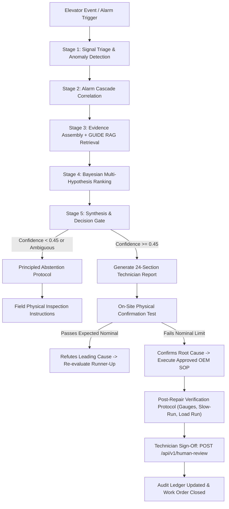

# Field Technician Diagnostic Loop & Human Review Protocol

## Overview
ElevateRCA is designed to assist, not replace, certified elevator technicians. Operating strictly as a read-only diagnostic assistant, it provides a closed-loop human verification workflow for resolving complex elevator anomalies.

---

## 1. The Closed-Loop Diagnostic Workflow



---

## 2. Technician Free-Text Evidence Interpretation (Section 25)

Field observations reported by technicians in work orders or dispatch logs are ingested using strict evidence classification:

| Raw Observation Text | Classified Type | Finding | Support Type | Diagnostic Weight |
|---|---|---|---|:---:|
| *"Roller rotates freely with zero visible wear"* | `PHYSICAL_INSPECTION` | No roller wear | `NEGATIVE` | **HIGH** (Penalizes roller hypothesis) |
| *"Track sill contains small stones and coins"* | `PHYSICAL_INSPECTION` | Debris in sill | `POSITIVE` | **HIGH** (Confirms sill obstruction) |
| *"Drive self-test PASSED, internal diagnostics clear"* | `OPERATIONAL_TEST` | Inverter healthy | `NEGATIVE` | **HIGH** (Rules out internal IGBT breakdown) |
| *"Independent optical leveling sensor normal"* | `MEASUREMENT` | Leveling true | `NEGATIVE` | **HIGH** (Rules out car floor drift, confirms encoder fault) |
| *"Brake air gap measured at 0.45 mm"* | `MEASUREMENT` | Air gap $+0.15\text{ mm}$ | `POSITIVE` | **HIGH** (Exceeds $0.30\text{ mm} \pm 0.05\text{ mm}$ tolerance) |
| *"I feel like the motor sounds a bit louder"* | `OPINION` | Subjective acoustic perception | `NEUTRAL` | **LOW** (Cannot eliminate or confirm hypothesis) |

---

## 3. "What Would Change the Diagnosis?" & Confirmation Protocols

To prevent confirmation bias, every ElevateRCA investigation report details explicit falsification criteria:

### Example: Drive Inverter Overcurrent (`motor_overcurrent`)
- **Primary Hypothesis:** VFD IGBT Power Electronics Breakdown ($P = 0.85$)
- **Runner-Up Hypothesis:** Hoistway Guide Rail Mechanical Jam ($P = 0.12$)
- **Confirmation Test:** Cold diode check across 6 inverter arms with digital multimeter (power isolated).
- **Expected Reading:** Forward drop $0.3\text{ V} - 0.7\text{ V}$; reverse infinite resistance ($> 10\text{ M}\Omega$).
- **If Test FAILS:** Internal IGBT breakdown confirmed. Proceed with inverter module replacement checklist.
- **If Test PASSES:** Inverter power module is intact! The diagnosis immediately shifts to runner-up hypothesis (`RC2` Mechanical Jam) or external motor stator winding insulation degradation (`RC4`).

---

## 4. Post-Repair Return-to-Service Protocol

Before returning an elevator to public passenger service, the technician must execute the 4-step verification sequence:
1. **Mechanical Clearance Check:** Verify nominal tolerances using calibrated gauges:
   - Brake air gap: $0.30\text{ mm} \pm 0.05\text{ mm}$
   - Door sill gap: $4.0\text{ mm} \pm 1.0\text{ mm}$
   - Door roller eccentric up-thrust clearance: $0.1\text{ mm} - 0.2\text{ mm}$
2. **Slow-Speed Inspection Run (TCI/ERO):** Traverse full hoistway height in inspection mode; verify motor current and car vibration remain below baseline anomaly thresholds.
3. **Safety Loop Trip Verification:** Individually trip landing door interlocks and car gate contacts to ensure the hardwired safety chain cuts drive power instantaneously.
4. **Full-Speed Autonomous Load Run:** Complete two autonomous floor-to-floor travel cycles with floor leveling precision verification ($< 5\text{ mm}$ sill deviation).

---

## 5. Human Sign-Off API Integration

Technicians record authorization decisions via `POST /api/v1/human-review`:

```json
{
  "investigation_id": "ELV-KONE-MONO-501-20260924T11000",
  "decision": "ACCEPTED",
  "technician_name": "Marcus Vance",
  "technician_badge": "KONE-TECH-8842",
  "notes": "Diode test confirmed open arm on Phase V upper IGBT. Replaced inverter power brick.",
  "override_hypothesis_id": null
}
```

The review is permanently stamped into the immutable audit ledger (`GET /api/v1/audit-log`).
